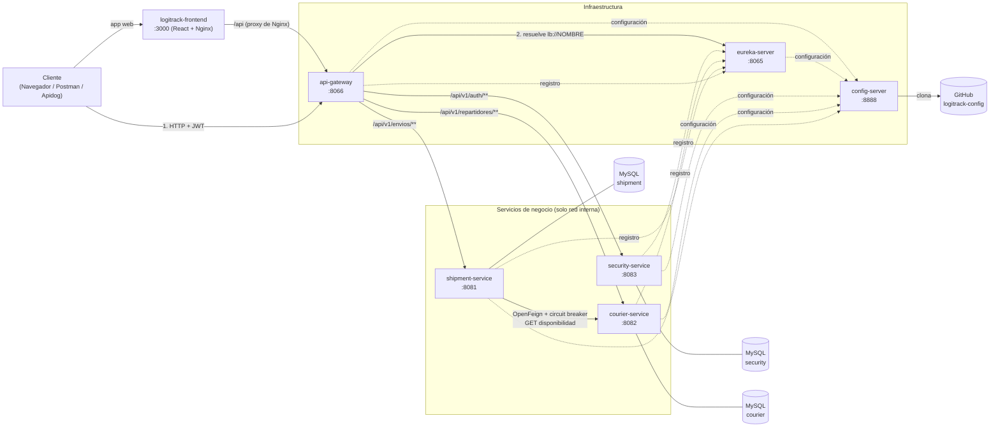

# LogiTrack · infraestructura

Repositorio que **levanta todo el sistema LogiTrack** (Desarrollo y Arquitecturas Avanzadas de Software, FI UNJu
2026): los seis servicios, el frontend y las tres bases MySQL, con Docker Compose.

## Repositorios del proyecto

| Repositorio | Puerto | Qué hace |
|---|---|---|
| `config-server` | 8888 | Entrega la configuración de cada servicio (Spring Cloud Config) |
| `eureka-server` | 8065 | Registro y descubrimiento de servicios (panel en http://localhost:8065) |
| `api-gateway` | 8066 | **Puerta de entrada única**: valida el JWT, revisa roles, CORS y enruta por Eureka |
| `security-service` | 8083 (solo red interna) | Usuarios, login (BCrypt) y emisión de JWT (HS256) |
| `courier-service` | 8082 (solo red interna) | Gestión de repartidores y su disponibilidad |
| `shipment-service` | 8081 (solo red interna) | Envíos; consulta a courier-service con OpenFeign (resuelto por Eureka) para asignar repartidores |
| `frontend` | 3000 | **Cliente web** (React servido por Nginx): http://localhost:3000. Le pasa `/api` al gateway por la red interna |
| `logitrack-config` | — | Archivos `.yml` por servicio y ambiente (lo lee el config-server) |
| **`infra`** (este) | — | `docker-compose`, scripts de base de datos y requests de prueba |

## Arquitectura

Toda petición externa entra por el **api-gateway**: valida el JWT, revisa los roles y enruta por nombre lógico,
que resuelve en **Eureka**. La configuración de todos viene del **config-server**. `shipment-service` consulta
a `courier-service` con **OpenFeign** (resuelto por Eureka), con ErrorDecoder, fallback y circuit breaker.



Línea continua: llamada HTTP. Línea punteada: registro en Eureka o lectura de configuración al arrancar.
Rutas del gateway, roles, flujo de una petición y tolerancia a fallos: [`docs/arquitectura.md`](docs/arquitectura.md).

## Cómo levantarlo (con las imágenes de Docker Hub)

Solo hace falta **Docker Desktop** abierto.

```bash
cp .env.example .env        # en PowerShell: copy .env.example .env
# completar .env (ver abajo)
docker compose up -d
docker compose ps
```

En 2 o 3 minutos tienen que aparecer los 10 contenedores en `healthy`. Después se abre la app en
**http://localhost:3000** y se entra con alguno de los [usuarios de prueba](#usuarios-de-prueba-por-rol).

### Usuarios de prueba por rol

security-service los crea solo al arrancar (S4-14), si no existen. La contraseña de los tres es la de
`USUARIOS_DEMO_PASSWORD` en el `.env` (en el `.env.example` es `gateway123`).

| Usuario | Rol | Qué puede hacer en la app |
|---|---|---|
| `gw.admin` | ADMIN | Ve todos los envíos; registra, asigna repartidor, cambia el estado y cancela. Da de alta, edita y activa o desactiva repartidores |
| `gw.cliente` | CLIENTE | Ve solo sus envíos; registra envíos nuevos, les asigna repartidor y los cancela mientras están pendientes |
| `gw.repartidor` | REPARTIDOR | Vinculado al repartidor **Brian Abalos**. Ve su hoja de ruta y pasa sus envíos a "En ruta" y a "Entregado" |

Desde la pantalla de login, "Crear una cuenta de cliente" registra usuarios nuevos. El registro público
**siempre crea un CLIENTE**, aunque el pedido diga otro rol (S4-14): nadie puede hacerse ADMIN o REPARTIDOR solo.
Los repartidores de ejemplo (Brian Abalos, Martín Quispe y Sofía Mamaní) y algunos envíos vienen en `db/init`.

### Orden de arranque y puertos

Docker Compose espera a que cada uno quede `healthy` antes de arrancar el siguiente (`depends_on` con
`condition: service_healthy`):

1. `config-server` (8888)
2. `eureka-server` (8065)
3. `security-service`, `courier-service` y `shipment-service`, cada uno con su base
4. `api-gateway` (8066)
5. `logitrack-frontend` (3000)

La app web está en `http://localhost:3000`: su Nginx le pasa `/api/...` al gateway por la red interna, así que
el navegador siempre le habla al mismo origen. Para la API, desde la PC **solo se entra por el gateway**:
`http://localhost:8066`. Los servicios security, courier y
shipment no publican puertos; el gateway los encuentra en Eureka por su nombre (`lb://SHIPMENT-SERVICE`,
etc.). También quedan publicados el panel de Eureka (8065), el config-server (8888) y las bases MySQL
(3307-3309), que se usan para correr los servicios desde el IDE.

### Completar el `.env`

| Variable | Qué poner |
|---|---|
| `DOCKERHUB_USER` / `IMAGE_TAG` | Usuario de Docker Hub (`macostag26`) y versión de las imágenes (`4.0.0`) |
| `FRONTEND_TAG` | Versión de la imagen del frontend (`1.0.0`) |
| `DB_USER` / `DB_PASSWORD` / `MYSQL_ROOT_PASSWORD` | Credenciales de MySQL (las que quieran) |
| `JWT_SECRET` | Obligatoria, **mínimo 32 caracteres**. La usan security-service y el api-gateway (y los servicios). Generar con `openssl rand -base64 48` |
| `USUARIOS_DEMO_PASSWORD` | Contraseña de los [usuarios de prueba](#usuarios-de-prueba-por-rol). Vacía: no se crean |
| `CORS_ALLOWED_ORIGINS` | Opcional: orígenes permitidos para CORS en el gateway, separados por coma |

PowerShell, sin `openssl`:

```powershell
$b = New-Object byte[] 48; [Security.Cryptography.RandomNumberGenerator]::Create().GetBytes($b); [Convert]::ToBase64String($b)
```

El `.env` tiene secretos y **no se sube a Git** (está en el `.gitignore`).

## Construir las imágenes desde el código

Hace falta cuando se cambió algo en un servicio y todavía no está publicado. Se clonan los repos uno al lado
del otro:

```
ProyectoFinalDAAS/
├── infra/
├── config-server/
├── eureka-server/
├── api-gateway/
├── frontend/
├── security-service/
├── courier-service/
└── shipment-service/
```

```bash
cd infra
docker compose -f docker-compose.yml -f docker-compose.build.yml up -d --build
```

## Imágenes publicadas en Docker Hub

La versión del Sprint 4 es la **`4.0.0`**. El único servicio que cambió respecto de la `3.0.0` es
security-service (registro público solo de clientes y usuarios de demo, S4-14); los demás son la misma imagen
con la etiqueta nueva, para que todo el sistema use una sola versión. Con el `.env` completo,
`docker compose up -d` descarga estas imágenes y levanta todo sin construir nada. La `3.0.0` (Sprint 3) y la
`1.0.0` (Sprint 2) siguen publicadas y no se modificaron.

| Imagen | Descarga |
|---|---|
| [`macostag26/logitrack-config-server:4.0.0`](https://hub.docker.com/r/macostag26/logitrack-config-server) | `docker pull macostag26/logitrack-config-server:4.0.0` |
| [`macostag26/logitrack-eureka-server:4.0.0`](https://hub.docker.com/r/macostag26/logitrack-eureka-server) | `docker pull macostag26/logitrack-eureka-server:4.0.0` |
| [`macostag26/logitrack-api-gateway:4.0.0`](https://hub.docker.com/r/macostag26/logitrack-api-gateway) | `docker pull macostag26/logitrack-api-gateway:4.0.0` |
| [`macostag26/logitrack-security-service:4.0.0`](https://hub.docker.com/r/macostag26/logitrack-security-service) | `docker pull macostag26/logitrack-security-service:4.0.0` |
| [`macostag26/logitrack-courier-service:4.0.0`](https://hub.docker.com/r/macostag26/logitrack-courier-service) | `docker pull macostag26/logitrack-courier-service:4.0.0` |
| [`macostag26/logitrack-shipment-service:4.0.0`](https://hub.docker.com/r/macostag26/logitrack-shipment-service) | `docker pull macostag26/logitrack-shipment-service:4.0.0` |

El frontend se publica con su propia versión (`FRONTEND_TAG` en el `.env`):

| Imagen | Descarga |
|---|---|
| [`macostag26/logitrack-frontend:1.0.0`](https://hub.docker.com/r/macostag26/logitrack-frontend) | `docker pull macostag26/logitrack-frontend:1.0.0` |

Los repositorios de Docker Hub son públicos: se descargan sin `docker login`.

## Publicar una versión nueva en Docker Hub

Para publicar cambios, se construye con una etiqueta nueva (nunca se pisa una ya publicada):

```bash
docker login
# en .env: IMAGE_TAG=4.0.1 (o la que siga)
docker compose -f docker-compose.yml -f docker-compose.build.yml build
docker compose -f docker-compose.yml -f docker-compose.build.yml push
```

## Probar que funciona

- App web: http://localhost:3000 (login, envíos y repartidores, según el rol)
- Panel de Eureka: http://localhost:8065 (tienen que aparecer `API-GATEWAY`, `SECURITY-SERVICE`,
  `COURIER-SERVICE` y `SHIPMENT-SERVICE` en `UP`)
- Health del gateway: http://localhost:8066/actuator/health (también 8065 y 8888)
- Login por el gateway: `POST http://localhost:8066/api/v1/auth/login`
- Configuración servida: http://localhost:8888/api-gateway/prod
- Carpeta `http/`: requests listos para ejecutar desde IntelliJ, un archivo por servicio (ver abajo).

### Pruebas en Apidog (`apidog/`)

La carpeta `apidog/` trae una colección con **135 requests** y sus aserciones, lista para importar en Apidog (o en
Postman), junto con el entorno `LogiTrack local` y un guion para la demostración. **Todas las requests entran por el
gateway** (`http://localhost:8066`). Incluye la infraestructura (Eureka con los servicios registrados), cada
servicio, la autorización por pertenencia, un escenario completo de punta a punta y las pruebas del gateway
(401, 403, rutas y CORS). Ver [`apidog/README.md`](apidog/README.md).

La verificación manual completa del sprint (checklist de 20 pasos) está en
[`docs/verificacion-sprint3.md`](docs/verificacion-sprint3.md).

### Requests de prueba (`http/`)

| Archivo | Qué prueba |
|---|---|
| `security.http` | Login de los usuarios de demo, registro de CLIENTES (y que pedir otro rol igual da CLIENTE), `/me` y errores (401, 409, 400). **Correr primero.** |
| `courier.http` | Alta, consulta y estado de repartidores, y el endpoint de disponibilidad que consume shipment-service |
| `shipment.http` | Ciclo de vida de un envío, historial y asignación de repartidores (comunicación con courier por OpenFeign) |
| `cliente.http` | Autorización por pertenencia: cada cliente solo ve sus envíos, el repartidor solo los asignados, el ADMIN todo |

Todos apuntan al gateway (`http://localhost:8066`). Cada archivo guarda el token en una variable global al hacer
login. Orden recomendado: `security.http`, `courier.http`, `shipment.http` y `cliente.http`.

## Detener

```bash
docker compose down        # frena y borra los contenedores
docker compose down -v     # además borra las bases (se recrean con los scripts de db/init)
```

## Problemas frecuentes

| Síntoma | Causa y solución |
|---|---|
| `Falta DB_PASSWORD` / `Falta JWT_SECRET` | No existe el `.env` o está incompleto |
| `security-service` (o cualquier servicio) se reinicia | `JWT_SECRET` con menos de 32 caracteres. Ver `docker compose logs security-service` |
| `config-server` no queda `healthy` | No llega a GitHub para clonar `logitrack-config`, o el repo es privado |
| Puertos ocupados (3000, 8066, 8065, 8888, 3307-3309) | Frenar lo que los usa, por ejemplo servicios corriendo desde el IDE |
| El gateway responde 503 justo después de levantar | Los servicios todavía no aparecen en Eureka: esperar unos 30 segundos |
| Datos viejos o esquema desactualizado | `docker compose down -v` y volver a levantar |
| `gw.admin` da "Credenciales inválidas" | Falta `USUARIOS_DEMO_PASSWORD` en el `.env`, o el usuario ya existía en la base con otra contraseña (los usuarios de demo no se pisan). Con `docker compose down -v` se recrean |
| Después de reiniciar Docker Desktop, eureka-server queda `unhealthy` | Los contenedores arrancaron en desorden. `docker compose down` y `docker compose up -d` |
