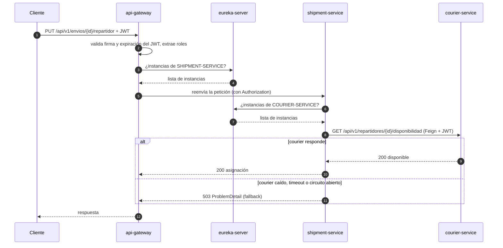

# Arquitectura de LogiTrack (Sprint 3)

El diagrama general de la arquitectura está en el [README](../README.md#arquitectura).

## Componentes

| Componente | Puerto | Se publica en el host | Responsabilidad |
|---|---|---|---|
| `api-gateway` | 8066 | **Sí** | Único punto de entrada. Enruta por nombre lógico, valida el JWT y aplica la autorización por roles |
| `eureka-server` | 8065 | Sí (panel) | Registro y descubrimiento de servicios |
| `config-server` | 8888 | Sí | Entrega la configuración desde el repositorio `logitrack-config` |
| `security-service` | 8083 | No | Usuarios, roles, login (BCrypt) y emisión de JWT (HS256) |
| `courier-service` | 8082 | No | Repartidores y su disponibilidad |
| `shipment-service` | 8081 | No | Envíos, tarifas, asignaciones y auditoría. Consulta a courier con OpenFeign |
| MySQL ×3 | 3307–3309 | Sí | Una base por servicio |

## Rutas del gateway

| Ruta | Destino | Acceso |
|---|---|---|
| `/api/v1/auth/**` | `lb://SECURITY-SERVICE` | Público |
| `/api/v1/repartidores/**` | `lb://COURIER-SERVICE` | `GET`: ADMIN, CLIENTE, REPARTIDOR. `POST`, `PUT`, `PATCH`: solo ADMIN |
| `/api/v1/envios/**` | `lb://SHIPMENT-SERVICE` | ADMIN, CLIENTE, REPARTIDOR (el detalle por rol y por pertenencia lo resuelve shipment-service) |

En `/api/v1/repartidores/**`, `POST`, `PUT`, `PATCH` y `DELETE` son solo de ADMIN. El gateway aplica las reglas
generales; la autorización fina y por pertenencia sigue en cada servicio, que también valida el JWT.

Un path que no está en la tabla (por ejemplo `/api/v1/otra-cosa`) responde 404 desde el gateway: los servicios no
son accesibles por ninguna otra ruta.

## Qué hace el gateway con cada petición

1. **CORS:** las peticiones *preflight* (`OPTIONS`) las contesta el gateway sin pedir token. Orígenes permitidos:
   `http://localhost:3000` y `http://localhost:5173` (variable `CORS_ALLOWED_ORIGINS`); métodos `GET`, `POST`, `PUT`,
   `PATCH` y `OPTIONS`; headers `Authorization` y `Content-Type`.
2. **Filtro JWT** (`FiltroJwtGlobal`): salvo `/api/v1/auth/**` y `/actuator/health`, exige
   `Authorization: Bearer <token>`. Valida firma (HS256, con el mismo `JWT_SECRET` que security-service) y
   vencimiento. Si falla → **401** `ProblemDetail`, título `No autorizado`, sin llegar al servicio.
3. **Filtro de roles** (`FiltroRolesGlobal`): aplica la tabla de arriba con los roles del token. Si el rol no
   alcanza → **403** `ProblemDetail`, título `Acceso denegado`.
4. **Enrutamiento:** resuelve `lb://NOMBRE` en Eureka, elige una instancia y reenvía la petición con el header
   `Authorization` intacto (los servicios vuelven a validarlo).

## Orden de arranque

1. `config-server`
2. `eureka-server`
3. `security-service`, `courier-service` y `shipment-service` (con sus bases de datos)
4. `api-gateway`

En el `docker-compose` se garantiza con `depends_on` y `condition: service_healthy`.

## Flujo de una petición: asignar un repartidor

## Tolerancia a fallos en la llamada a courier-service

| Situación | Respuesta de shipment-service |
|---|---|
| courier responde 200 y el repartidor está disponible | 200, se asigna |
| courier responde 200 y el repartidor está inactivo | 422 |
| courier responde 404 (repartidor inexistente) | 404 |
| courier responde 5xx | 503 (`ErrorDecoder`) |
| courier caído, timeout o sin instancias en Eureka | 503 (fallback) |
| Falla repetida: el circuito se abre (10 s) | 503 inmediato, sin llamar a courier |

Siempre con formato `ProblemDetail`, nunca un 500 ni un stack trace.
